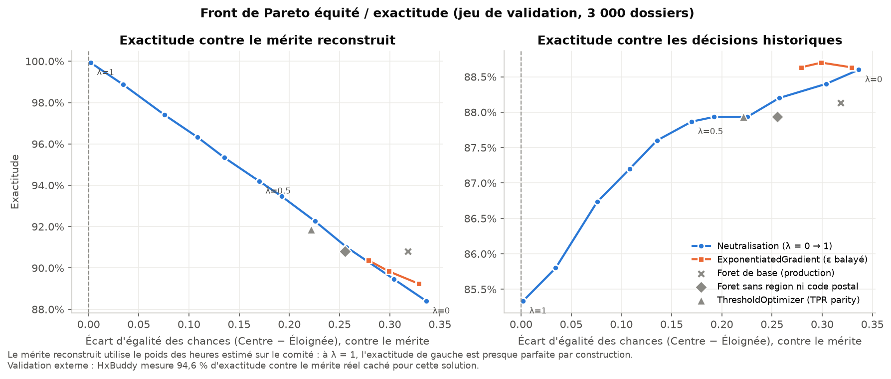

# ÉquiAlgo — des bourses au mérite, pas à l'adresse

**Équipe ICEMEN** · Hackathon Génie et Informatique 2026 · Défi IVADO ÉquiAlgo (24 h)

Le modèle en production accorde une bourse à 48 % des candidat·es des grands centres et à 27 % des
régions éloignées. Notre audit montre que la cote R n'explique qu'une petite partie de cet écart : la
pénalité liée à la région en explique à elle seule environ 80 %, et elle passe par des proxys (code postal,
distance, revenu). Nous la corrigeons par **neutralisation contrefactuelle** : le modèle apprend le comité
*avec* la région et le revenu, puis on retire ces termes au moment de décider.

> **English summary.** The production model awards 48% of applicants from the main centres and 27% from
> remote regions. A logistic decomposition of past committee decisions shows a regional penalty worth
> about 1.5 R-score points (≈ 80% of the gap) plus an income channel. Proxies (postal code, distance,
> hours worked, income) make "fairness through unawareness" fail. We fit the committee *with* region,
> income and distance, neutralize those terms at decision time and award the top 40%. Result: 40.0% in
> both groups, an equal-opportunity gap of ≈ 0 against our reconstructed merit, and 94.63% accuracy /
> 94.40% macro-F1 against the hidden reference (HxBuddy).

L'énoncé du défi se trouve dans `LISEZMOI.md`, `consignes-fr.pdf` et `consignes-en.pdf`.

## Résultats en bref

| | Modèle en production | Notre modèle |
|---|---|---|
| Taux d'octroi global (4 000 candidat·es) | 39,1 % | **40,0 %** |
| Taux d'octroi Centre / Éloignée | 46,8 % / 27,8 % | **40,0 % / 40,0 %** |
| Écart d'égalité des chances, contre le mérite reconstruit | 0,296 | **≈ 0** |
| Exactitude contre la référence cachée (HxBuddy) | non soumis | **94,63 %** (F1 macro 94,40 %) |
| Exactitude contre les décisions historiques (validation) | 88,1 % | 85,3 % |

La dernière ligne résume notre position : on perd un peu d'exactitude contre un comité biaisé, et on en
gagne contre le mérite réel.

## Structure du dépôt

```
predictions.csv          soumission finale : 4 000 décisions, 40,0 % d'octroi
audit_rapport.ipynb      diagnostic : mesure du biais, métriques d'équité, proxys, plafond d'exactitude
model_corrige.py         correction + front de Pareto (écrit predictions.csv, pareto.png, resultats_pareto.csv)
commun.py                fonctions partagées : chargement, groupes, sélection top-k, métriques, style
pareto.png               front de Pareto équité / exactitude
resultats_pareto.csv     chiffres du front de Pareto
presentation.pdf         support du pitch de 5 minutes
baseline_model.ipynb     modèle de départ fourni (inchangé)
data/                    données fournies (inchangées, vérifiées contre manifest.json)
requirements.txt         dépendances (statsmodels ajouté pour l'audit)
```

## Reproduire

```bash
python3 -m venv venv && source venv/bin/activate      # Windows : venv\Scripts\activate
pip install -r requirements.txt
python model_corrige.py                                # ~10 s
jupyter nbconvert --to notebook --execute --inplace audit_rapport.ipynb
```

Tout est déterministe (graines fixées). `model_corrige.py` réécrit exactement le `predictions.csv` soumis
et vérifie lui-même l'enveloppe (36–44 %) et le format (4 000 lignes, valeurs 0/1).

> Attention : la dernière cellule de `baseline_model.ipynb` (fourni) réécrit `predictions.csv` avec le modèle
> biaisé. Si vous l'exécutez, relancez `python model_corrige.py` ensuite.

## 1. Diagnostic — `audit_rapport.ipynb`

- **Écart brut.** 48,4 % d'octroi à Montréal et dans la Capitale-Nationale, contre 27,3 % au
  Bas-Saint-Laurent, sur la Côte-Nord et en Gaspésie–Îles-de-la-Madeleine : 21 points.
- **À cote R égale, l'écart persiste.** Dans une régression logistique des décisions du comité, la pénalité
  « région éloignée » vaut ≈ 1,5 point de cote R. Évalués comme au Centre, les dossiers éloignés
  passeraient de 27,3 % à 44,7 % d'octroi : la région elle-même explique ≈ 80 % de l'écart.
- **Deuxième canal : le revenu.** À cote R égale, doubler le revenu familial vaut ≈ 0,9 point de cote R.
  Le revenu médian est ≈ 52 k$ en région contre ≈ 69 k$ au Centre.
- **Les heures travaillées sont récompensées** (≈ 0,15 point R par heure). Nous les traitons comme un
  critère de mérite (section 2).
- **Proxys.** AUC pour deviner la région : code postal 1,000 · distance 0,998 · heures 0,805 · revenu 0,693.
  Sans aucune colonne géographique, on la devine encore à 0,849. Voilà pourquoi retirer
  `region_administrative` ne fait passer l'écart de parité que de 0,188 à 0,181.

## 2. Métrique d'équité et mérite de référence

**Métrique retenue : égalité des chances.** Parmi les candidat·es qui méritent la bourse, la chance de
l'obtenir doit être la même dans les deux groupes. C'est la notion qui correspond à une bourse au mérite.
La parité démographique, elle, imposerait des taux égaux même si le mérite différait.

**Le mérite doit être mesuré indépendamment du comité.** Calculer l'égalité des chances contre
`decision_octroi` ne fait que vérifier que le modèle copie bien le comité. Nous reconstruisons le mérite
comme **cote R + 0,146 point par heure travaillée**, sans région ni revenu. Trois vérifications :

1. Contre ce mérite, le modèle de production a un écart d'égalité des chances de 0,266. Les organisateurs
   publient 0,270. Les autres définitions testées donnent entre 0,017 et 0,213.
2. HxBuddy mesure **94,63 %** d'exactitude et 94,40 % de F1 macro contre la référence cachée.
3. Ces deux scores impliquent que la référence contient 39,8 % à 40,1 % de dossiers méritants : notre seuil
   de 40 % est le bon.

Avec ce mérite, les deux groupes méritent la bourse au même taux (40 % / 40 %). Ici, égalité des chances
et parité démographique pointent donc dans la même direction.

## 3. Solution — `model_corrige.py`

**Neutralisation contrefactuelle :**

1. Une régression logistique apprend les décisions historiques **avec** la région, le revenu (log) et la
   distance. Le biais est rangé dans des coefficients identifiables au lieu de se cacher dans les proxys.
2. Au moment de décider, ces termes sont neutralisés : tout le monde est évalué avec la même région, le
   même revenu et la même distance. Le programme et la première génération, sans effet mesurable
   (p > 0,5), sont aussi neutralisés. Les garder pénaliserait légèrement les étudiant·es de première génération.
3. Les 40 % meilleurs scores reçoivent la bourse : l'enveloppe (36–44 %) est respectée par construction.

Le score final est **cote R + 0,146 × heures**. Il ne permet plus de deviner la région (AUC 0,501, contre
0,554 pour la cote R seule). Par rapport au modèle en production, 201 dossiers des régions éloignées gagnent
une bourse et 2 la perdent ; au Centre, 173 la perdent et 12 la gagnent.

**Plafond.** Des formes plus flexibles (interaction cote R × heures, splines) ne prédisent pas mieux le comité
en validation croisée, et déplacer le poids des heures dans son intervalle de confiance (0,130 à 0,161) ne
change qu'une vingtaine de décisions. Les ≈ 5 % d'erreurs restantes sont une variation aléatoire de la
référence qu'aucune colonne ne contient (audit, section 6b).

## 4. Front de Pareto

Un paramètre λ dose la correction : 0 copie le comité, 1 neutralise complètement. On le balaie et on compare
avec `ThresholdOptimizer` et `ExponentiatedGradient` de fairlearn, sur un jeu de validation de 3 000 dossiers.



- Contre le mérite, l'exactitude **monte** quand l'écart se referme (88 % → ≈ 100 %\*). Contre les décisions
  historiques, elle **descend** (88,6 % → 85,3 %). Le compromis équité / exactitude n'existe que si l'on
  mesure contre des étiquettes biaisées.
- Les outils fairlearn, contraints par rapport aux décisions historiques, laissent un écart de 0,22 à 0,33
  (0,32 pour le modèle en production) : ils égalisent les chances *par rapport au comité*, pas par rapport
  au mérite.

\* À λ = 1, l'exactitude contre le mérite reconstruit est presque parfaite par construction. La validation
indépendante est le 94,63 % de HxBuddy.

## 5. Limites

- **Le mérite est reconstruit, pas observé.** Il repose sur le comportement du comité, sur l'écart publié de
  0,270 et sur le score indicatif HxBuddy. En production, il faudra une vraie mesure du mérite (section 6).
- **Choix de valeurs sur les heures travaillées.** Elles rapprochent les groupes, mais elles récompensent le
  travail rémunéré et pas d'autres contraintes de temps (proche aidance, handicap, famille). Ce choix doit
  être validé par un comité d'éthique et élargi si possible.
- **Deux blocs régionaux.** Nous suivons l'audit officiel (Centre / Éloignée). Par région, notre taux
  d'octroi va de 38,3 % (Bas-Saint-Laurent) à 41,5 % (Gaspésie–Îles-de-la-Madeleine).
- **Sous-groupes.** Première génération : 40 % dans les deux groupes. Les croisements plus fins (programme ×
  région) ont des effectifs trop petits pour conclure.
- **Données synthétiques.** Les relations y sont plus nettes (linéaires, sans interactions) qu'en réalité.
- **Effets redistributifs.** 173 candidat·es du Centre perdent une bourse qu'ils auraient eue avec l'ancien
  modèle. C'est la correction d'un avantage indu, mais elle doit être expliquée et accompagnée.

## 6. Gouvernance et plan de surveillance en production

### Fiche modèle

| | |
|---|---|
| Usage prévu | Classer les demandes de bourses d'excellence pour une enveloppe fixe, en aide à la décision du comité |
| Hors champ | Prêts d'études (solvabilité), autres programmes, décisions sans revue humaine des cas limites |
| Variables qui décident | Cote R, heures travaillées par semaine |
| Variables d'audit seulement | Région, code postal, revenu, distance, première génération, programme : stockées à part, accès restreint |
| Seuil | 40 % meilleurs scores (enveloppe 36–44 %) |
| Performance | 94,63 % d'exactitude, 94,40 % de F1 macro contre la référence (HxBuddy) |

### Indicateurs surveillés

| Indicateur | Mesure | Seuil d'alerte | Fréquence | Action |
|---|---|---|---|---|
| Enveloppe | Taux d'octroi global | Hors 38–42 % (limite dure 36–44 %) | Chaque cycle | Bloquer la publication, recalibrer le seuil |
| Parité | Taux par groupe et par région | Écart > 5 points | Chaque cycle | Enquête : mérite différent ou nouveau biais ? |
| Égalité des chances | Révision à l'aveugle de 200 dossiers par cycle (région, code postal, revenu masqués) | Écart > 0,05 (critique > 0,10) | Chaque cycle | Comité d'éthique ; > 0,10 → arrêt (ci-dessous) |
| Neutralité du score | AUC du score pour deviner la région | > 0,60 (aujourd'hui 0,50) | Chaque cycle | Chercher le nouveau proxy |
| Dérive | PSI de la cote R et des heures, par région | PSI > 0,2 | Mensuelle | Ré-estimer le poids des heures |
| Poids des heures | Ré-estimation avec intervalle de confiance | Sort de 0,130–0,161 | Annuelle | Décision du comité d'éthique |
| Sous-groupes | Région × première génération, × programme (n ≥ 50) | Écart > 5 points | Semestrielle | Analyse ciblée |
| Révisions et contestations | Taux de décisions renversées, par groupe | Asymétrie > 5 points | Chaque cycle | Revoir la zone des cas limites |
| Validité du mérite | Réussite après un an des boursier·ères, par groupe | Écart > 5 points | Annuelle | Réviser la définition du mérite |

### Rôles

- **Responsable du modèle** (science des données) : maintenance, rapport d'équité à chaque cycle.
- **Comité d'éthique et d'équité** : approuve le poids des heures, les seuils et chaque nouvelle version.
- **Conformité et juridique** : Loi 25, Charte des droits et libertés de la personne.
- **Comité d'octroi** : revoit les cas limites (score à ± 0,5 point du seuil, ≈ 13 % des dossiers) et les contestations.
- **Auditeur externe** : audit annuel indépendant.

### Transparence et recours

- La Loi 25 (article 12.1 de la *Loi sur la protection des renseignements personnels dans le secteur privé*)
  oblige à informer la personne visée par une décision fondée exclusivement sur un traitement automatisé, et
  à lui donner l'occasion de présenter ses observations à un membre du personnel en mesure de réviser la
  décision. Un score à deux facteurs (cote R, heures) est simple à expliquer.
- La Charte des droits et libertés de la personne (article 10) interdit la discrimination fondée sur la
  condition sociale. Le canal « revenu » du comité historique mérite un examen juridique. Notre modèle
  n'utilise pas le revenu pour décider.

### Arrêt et retour arrière

- Si l'enveloppe sort de 36–44 % ou si l'écart d'égalité des chances dépasse 0,10, la décision automatisée
  est suspendue. Le comité reprend avec une révision à l'aveugle jusqu'à correction.
- Le modèle, les données d'entraînement et le seuil sont versionnés. Toute modification passe par le comité
  d'éthique.

## Références

- [Commission d'accès à l'information — principaux changements apportés par la Loi 25](https://www.cai.gouv.qc.ca/protection-renseignements-personnels/sujets-et-domaines-dinteret/principaux-changements-loi-25)
- [Commission des droits de la personne et des droits de la jeunesse — la Charte](https://www.cdpdj.qc.ca/fr/vos-droits/lois-qui-protegent-vos-droits/charte)
- [fairlearn](https://fairlearn.org) — `ThresholdOptimizer`, `ExponentiatedGradient`, `MetricFrame`

Toutes les données sont synthétiques et l'institution est fictive.
